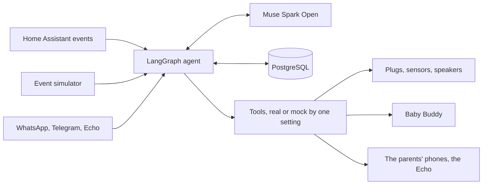

# Theo's house

Built by Gonzalo.

Built during the Meta hackathon, Oct 26 to Nov 4 2026. This repo is a cleaned copy of my private repo. The commits and their dates are kept. Surnames, the home's full device list, camera notes and the files named below are removed from all history. Some real device names remain in the code. The first commit is on Oct 26 at 15:03, after kickoff.

## Prior work

| Built before Oct 26 | Where it is |
|---|---|
| Recipe Sender, my Cookidoo recipe app | Not in this repo. The new Muse connector brief is in `apps/recipe-connector/` |
| A bare-bones hand alarm prototype | Rebuilt during the event on SAM 3.1. `reflex.py` and `alarm.py` are removed from history. Other first-day commits on Oct 26 carried over code from the prep repo, such as the phone page and camera sources, and most of it was replaced during the event. A few generic lines remain |
| A bare-bones hearing prototype | Rebuilt during the event on Perception Encoder Audio |
| A small test of Muse making decisions | Replaced by this agent |
| Our Home Assistant home | Not in this repo. The agent connects to it |
| Generated test clips, Oct 22 and 23 | The hand alarm's test set in `results/sam-hand/` and the demo clips use them |
| Our nursery's measurements, Sep 2026 | In `parenting_agent/prep/nursery.py`, marked as prior work there |

Built during the event: the agent, its tools, the sensor firmware, the Alexa skill, the glasses app, the judge simulator and the Muse connector brief.

Theo arrives in December. We are first-time parents, building our home for his first month. This is one persistent agent on our home server. It hears voice notes, has a car seat coach built for Meta's glasses kit, and moves the house, so Ceci and I can spend that month with him.

Nobody asks it first. A sensor changes, a cry is heard, or a parent sends a voice note, and **Muse Spark Open decides** what to do through tools.

## Try it

The judge simulator runs the same agent on a simulated home. You send the events Home Assistant sends, Muse decides live, and nothing reaches a real house. It's hosted at https://simulator.bygmv.com. To run it yourself you need PostgreSQL and a Baseten key:

```bash
pip install -r requirements.txt -r requirements-core.txt
BASETEN_API_KEY=... PA_DB_URL=postgresql://... python -m parenting_agent.simulator --port 8781
```

Move the humidity slider or fire a cry, then watch the raw event next to the tools Muse chose. The moments from the video are only shortcuts that send events, so a different home can give a different result. `docs/simulator.md` has the rest.

The tests need no key and no house: `python -m unittest discover -s tests`. Set `PA_DB_URL` to a local PostgreSQL to include the agent core and simulator tests. Without it, those tests skip.

## A day

This is the story from the video. In the simulator it runs on real Muse in a simulated home, on a prompt tuned against these moments, so it shows the story works and not how often Muse is right (`results/simulator-first/`).

| When | What happens |
|---|---|
| 02:50 | Theo cries, an event the page sends. On the mock home, only the phone of the parent on duty lights up. Meta's audio model hears cries on recordings, not on this page |
| Night | "Le di 90 ml a las 3", typed here as a voice note. Muse logs it and answers in text |
| 07:30 | On the mock home, each parent gets a different morning message, and nobody asked for it. At home it reached me on WhatsApp on Nov 4 |
| Daytime | On the mock home, Grandma asks the Echo when he last ate. Muse answers from his log |
| Before a drive | A parent asks for help and Muse starts the car seat coach. It goes step by step, shown as a recording. It never says safe |
| Afternoon | Humidity in his room rises, and Muse switches on the dehumidifier's plug. This one is real at home too, see below |
| 20:00 | Ceci asks to sleep. The night moves to me and Muse plans it |

## How it works



- **Persistent:** LangGraph checkpoints in PostgreSQL keep one thread per home, across days and restarts. Events and actions are on record.
- **Proactive:** Home Assistant's WebSocket and a schedule wake Muse. A schedule only wakes it, and it decides from there.
- **Devices:** Home Assistant's MCP server, limited by an allow list (`parenting_agent/core/settings.py`, policy in `docs/house-policy.md`).
- **Limits in code, outside Muse:** red flags, no medical advice, and a check that messages don't claim what the log doesn't say.

| Part | Where |
|---|---|
| The agent | `parenting_agent/core/` |
| The judge simulator | `parenting_agent/simulator/`, `deploy/simulator/` |
| Glasses app on Meta's Device Access Toolkit | `apps/glasses/` |
| Alexa skill | `apps/alexa/` |
| Recipe connector brief for Muse | `apps/recipe-connector/` |
| Nursery sensor on Meta's Muse Gadgets SDK | `deploy/nursery-firmware/`, `deploy/nursery-mcp/` |
| Skills for the changing table, the bath and the car seat. The bath's results aren't claimed | `skills/` |
| Hand alarm and car seat vision on SAM 3.1 | `parenting_agent/sam3_worker.py`, `parenting_agent/sam_hands.py`, `parenting_agent/carseat/` |
| Cry and house sounds on Perception Encoder Audio | `parenting_agent/hearing.py`, `parenting_agent/hearing_worker.py` |
| One parent, one language helper, on recorded clips | `parenting_agent/opol.py`, `results/opol/` |
| First-month book, a labelled sample of 30 simulated days | `parenting_agent/core/book.py`, `results/book-sample/` |
| Dog near the baby watch | `parenting_agent/dog_watch.py`, `results/dog-near-baby/` |
| White noise, simulated device | `parenting_agent/white_noise.py` |
| Daily laundry, simulated plug | `parenting_agent/laundry.py`, `results/laundry/` |
| Before-birth lists | `parenting_agent/prep/` |
| Test results | `results/` |

## Meta models

| Model | What it does |
|---|---|
| Muse Spark Open, on Baseten | Decides through tools, and hears voice notes |
| SAM 3.1, local | Sees hands and car seat steps, on recordings |
| Perception Encoder Audio, local | Hears crying and house sounds, on recordings |
| MMS-TTS, local | Speaks the car seat coach's lines. This agent's own replies aren't spoken with it |

I built the sensor for Theo's room on Meta's Muse Gadgets SDK. It reports to Home Assistant, so my home agent can read it. It isn't paired with Muse.

## Real and simulated

| Part | State | Record |
|---|---|---|
| Muse deciding on a real humidity event and switching a real plug | Real, on the home server | `results/core-first/`, `results/core-vostro/` |
| The nursery sensor reading, through Home Assistant's WebSocket | Real | `results/core-first/` |
| Memory after the container is recreated | Real, one run | `results/core-vostro/` |
| Baby Buddy read and write | Real, on a test child | `results/core-vostro/` |
| Muse hearing a voice note and MMS answering | Real models, on the earlier agent. The voices are synthetic and Telegram was faked in the run | `results/voice/` |
| WhatsApp through Twilio's sandbox, for both parents | Real | `docs/whatsapp.md`, `results/real-home-2026-11-04/` |
| WhatsApp voice notes, heard and answered | Real, 2 notes on Nov 4 | `results/real-home-2026-11-04/` |
| The kitchen Echo answering from his log, and moving the night duty when asked | Real, Nov 4 | `results/real-home-2026-11-04/` |
| A recorded cry played aloud near the Tapo camera, reaching a parent as one WhatsApp message | Real, one test, not a rate | `results/real-home-2026-11-04/` |
| Muse reading 76.5% in Theo's room and turning on the dehumidifier's plug, from its own wake | Real, Nov 4 at 16:26. Test messages came before it, listed in the record | `results/real-home-2026-11-04/` |
| Theo | Simulated, he isn't born yet | |
| Glasses | Meta's mock kit, because we don't own the glasses. That run was on the earlier agent, not this one | `results/glasses/` |
| Hand alarm and cry recordings | Generated, rendered or public recordings, not a real baby | `results/sam-hand/`, `results/senses-recheck/` |
| Car seat coach on the core | One run on a public video in a loop. It proves the path, not the vision | `results/core-coach/` |
| Bottle warmer in the video | Simulated | |
| Car seat video in the simulator | A recording, labelled as one | |

## Results

**The agent.** Last held-out round on real Muse: **36 of 48**, on 16 new cases written before the run, on a mock home with a mock channel (`results/core-jobs/held-out-14.json`). Fixes made after it have no held-out proof. Every round, the misses and what was tuned on are in `results/core-jobs/CASES.md`. The review agents and any "judge" rounds in the history are my own AI reviewers, not the hackathon's judges.

**Emergency lines.** 56 lines, none missed, 3 of 3 runs, on the mock home and tuned against these same lines (`results/core-jobs/CASES.md`).

**Cries.** Perception Encoder Audio on recordings: **323 of 348** cries caught on a reused held-out set, 1 false alarm in 157 human sounds, most of them synthetic (`results/ear-path/`, `results/ear-false-alarms/`).

**Car seat.** Muse on 2 stills got the belt's route right in only 14 of 42 looks, so the coach asks the parent to look instead (`results/carseat/routing/`).

**The hand alarm.** SAM 3.1 alone at the changing table, on recordings: **33 of 51** within 2.5 s, **42 of 51** within 5 s, and no false alarms in 29 (`results/sam-hand/`). The recordings are generated or rendered. The bath isn't claimed, it missed too many.

## Privacy

Video and house audio stay in your house, apart from two opt-in senses. Messages, voice notes and the log lines the agent reads go to the brain.

| Data | Where it goes |
|---|---|
| Camera frames | Stay in memory on the Mac, where SAM 3.1 runs. Nothing is saved, only numbers and states. Opt-in, off by default: `car_seat.muse` sends one zoomed still per car seat step to Muse on Baseten |
| House audio | Labelled on the Mac by Perception Encoder Audio and never saved. Opt-in, off by default: `house_sounds.muse_audio` may send the first seconds of a detected cry to Muse, only after a synthetic audio canary passes. The canary failed, so no house audio has been sent (`docs/house-sounds.md`) |
| The baby's log | Baby Buddy on our server (`docs/deploy-babybuddy.md`) |
| The agent's memory | PostgreSQL on the machine that runs it |
| Messages, tool results, voice notes | Go to Muse Spark Open on Baseten, the only model called off the Mac. That includes the log lines a question reads. Telegram voice notes go there too, as audio, and so do WhatsApp voice notes: held in memory, sent once and never saved by us |
| Training | Muse runs on the hackathon's free credits. Meta said on the event's Discord that on those credits "your content may be used to train future Meta models". So what goes to Muse may be kept and used for training, and we don't promise otherwise |
| Telegram, WhatsApp through Twilio | Messages pass through their servers (`docs/whatsapp.md`) |
| The kitchen Echo | Everything said to it goes to Amazon, as with any Alexa command. The skill's path also goes through an AWS Lambda, whose log keeps each question and answer (`docs/echo-and-assist.md`) |
| Cloudflare | The judge simulator and the Echo skill's path reach the home server through a Cloudflare tunnel. Visitors to the simulator talk about a simulated Theo, and their messages go to Muse too |

In this repo the family goes by first names, and addresses, phone numbers and tokens are left out or replaced with placeholders. The GitHub handle is mine. The entity names you see come from our home with those names replaced, so `person.gonza` and `192.0.2.10` won't match a real house.

## Not medical advice

The agent reads back what the log says and refers health questions to your pediatrician. It never says a car seat is safe.

## License

MIT for our code. Third-party models and terms are in `THIRD_PARTY.md`.
