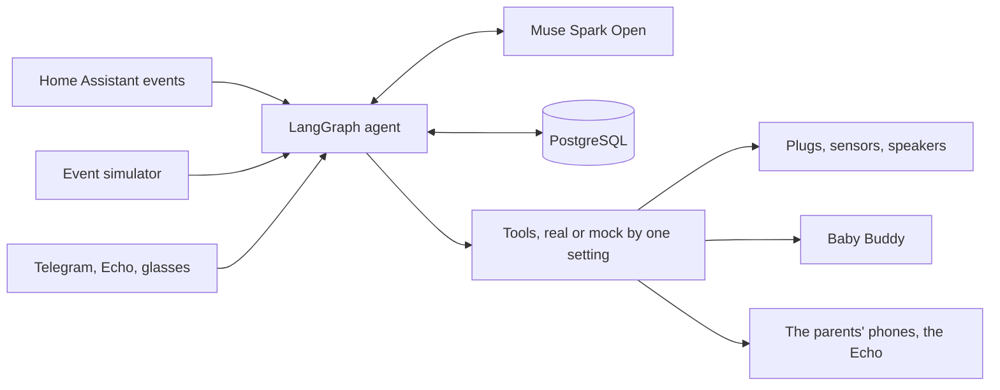

# Theo's house

**What existed before and what we built.** Before the hackathon I had small experiments with hand detection, audio labels and Home Assistant, and none of that code is in this repo. Everything here was built during the event, from Oct 26 2026. That includes the agent, its tools, the sensor firmware, the Alexa skill, the glasses app and the judge simulator.

Theo arrives in December. We are first-time parents, building our home for his first month. This is one persistent agent on our home server. It hears us, sees through Meta's glasses kit, and moves the house, so Ceci and I can spend that month with him.

Nobody asks it first. A sensor changes, a cry is heard, or a parent sends a voice note, and **Muse Spark Open decides** what to do through tools.

## Try it

The judge simulator runs the same agent on a simulated home. You send the events Home Assistant sends, Muse decides live, and nothing reaches a real house.

```bash
pip install -r requirements.txt -r requirements-core.txt
BASETEN_API_KEY=... PA_DB_URL=postgresql://... python -m parenting_agent.simulator --port 8781
```

Move the humidity slider or fire a cry, then watch the raw event next to the tools Muse chose. The moments from the video are only shortcuts that send events, so a different home can give a different result.

## A day

| When | What happens |
|---|---|
| 02:50 | Theo cries. Meta's audio model hears it at home, and only the phone of the parent on duty lights up |
| Night | "Le di 90 ml a las 3" as a voice note. Muse logs it and MMS answers out loud |
| 07:30 | Each parent gets a different morning message, and nobody asked for it |
| Daytime | Ceci asks the glasses how many diapers. Grandma asks the Echo when he last ate. Muse answers from his log |
| Before a drive | The car seat coach goes step by step, and SAM 3.1 checks each step on camera. It never says safe |
| Afternoon | Humidity in his room rises, and Muse turns on the dehumidifier |
| 20:00 | Ceci asks to sleep. The night moves to me and Muse plans it |

## How it works



- **Persistent:** LangGraph checkpoints in PostgreSQL keep one thread per home, across days and restarts. Events and actions are on record.
- **Proactive:** Home Assistant's WebSocket and a schedule wake Muse. A schedule only wakes it, and it decides from there.
- **Devices:** Home Assistant's MCP server, limited by an allow list (`docs/house-policy.md`).
- **Limits in code, outside Muse:** red flags, no medical advice, and a check that messages don't claim what the log doesn't say.

| Part | Where |
|---|---|
| The agent | `parenting_agent/core/` |
| The judge simulator | `parenting_agent/simulator/`, `deploy/simulator/` |
| Glasses app on Meta's Device Access Toolkit | `apps/glasses/` |
| Alexa skill | `apps/alexa/` |
| Nursery sensor on Meta's Muse Gadget SDK | `deploy/nursery-firmware/`, `deploy/nursery-mcp/` |
| Results of every test | `results/` |

## Meta models

| Model | What it does |
|---|---|
| Muse Spark Open, on Baseten | Decides every step, and hears voice notes |
| SAM 3.1, local | Sees hands and car seat steps |
| Perception Encoder Audio, local | Hears crying and house sounds |
| MMS-TTS, local | Speaks replies |

I built the sensor for Theo's room on Meta's Muse Gadget SDK. It reports to Home Assistant, so both Meta Muse and my home agent can read it.

## Real and simulated

| Part | State |
|---|---|
| Muse deciding on a real sensor event and moving a real plug, on the home server | Real |
| Memory after the container is recreated | Real |
| The nursery sensor reading | Real |
| Voice note through the voice service and Muse | Real |
| Baby Buddy read and write | Real |
| Theo | Simulated, he isn't born yet |
| Glasses | Meta's simulator, because we don't own the glasses |
| Bottle warmer in the video | Simulated |
| Car seat video in the simulator | A recording, labelled as one |

## Results

On Nov 3, on 12 new cases not used for tuning, against the real Muse on a mock home: **33 of 36**. The misses are in `results/core-jobs/CASES.md`: the plug stayed on in a dry room twice, and one question got no reply. Other rounds there were tuned on, and the file says which.

## What stays home and what leaves

Video and house audio stay in your house, apart from two opt-in senses. Messages, voice notes and the log lines the agent reads go to the brain.

| Data | Where it goes |
|---|---|
| Camera frames | Stay in memory on the Mac. SAM 3.1 and the hand detector run locally. Nothing is saved, only numbers and states in `runs/`. Opt-in exception, off by default: with `car_seat.muse` on, one zoomed still per car seat camera step goes to Muse Spark Open on Baseten |
| House audio | Labelled on the Mac by Meta's Perception Encoder Audio, never saved, only labels and numbers in `results/` (see `docs/house-sounds.md`). Opt-in exception, off by default: the first 5 s of a detected cry may go to Muse Spark Open on Baseten for a guess at the reason, and only after a synthetic audio canary passes. On Oct 28 and 29 the canary failed, so no house audio has been sent. A voice note a parent sends on Telegram is different: it goes as audio to Muse on Baseten to be written down |
| The baby's log | Baby Buddy on the family's server, reachable only on that server (see `docs/deploy-babybuddy.md`) |
| The agent's memory | PostgreSQL on the machine that runs it |
| **What leaves the house** | The brain call: the conversation text and tool results (baby log lines included) go to Muse Spark Open on Baseten, the only model called off the Mac. Every call logs its destination host as a `brain_call` event. Telegram voice notes go there too, as audio, on by default in the family agent and the families bot: the note is held in memory, converted in the house and sent once to inference.baseten.co, never saved by us. Telegram messages also go through Telegram's servers. |
| **Training** | Muse runs on the hackathon's free credits. Meta said on the event's Discord (Oct 27) that on the free credits "your content may be used to train future Meta models". So the messages, the tool results with their log lines and the voice notes sent to Muse may be kept and used for training. We do not promise otherwise. What stays home: the Baby Buddy database itself (the log lines a question reads still go to Muse in the tool results), the video frames and the house audio, apart from the two opt-in senses below |
| **Opt-in senses** | Apart from voice notes, no frame and no audio leaves, except two opt-in Muse senses, both off by default, that are part of the brain call to Baseten: one zoomed still per car seat camera step (`car_seat.muse`, the same still in 3 parallel calls by default for a majority vote), and the first 5 s of a detected cry (`house_sounds.muse_audio`, never sent so far because the canary failed). Each is made in memory and dropped after the call. See `docs/car-seat-coach.md` and `docs/house-sounds.md` |
| **The kitchen Echo (Amazon)** | Everything said to the Echo goes to Amazon's Alexa cloud, as with any Alexa command. Two paths reach the agent. The Home Assistant path (live since Oct 31, read only): Alexa's cloud turns the words into text, Home Assistant's Alexa Devices integration reads them from Amazon, and the agent's answer goes back to Amazon to be spoken. The "baby agent" skill (Oct 31, private, development stage on Gonza's Amazon account): Alexa's cloud sends the words to an AWS Lambda in us-east-1, the Lambda posts them through Cloudflare to the agent on the Vostro and speaks the reply. The Lambda's AWS log keeps each question's words and the answer. So the answers' log facts (a time, an amount, a diaper) reach Amazon. Announcements to the Echo also go through Amazon. See `docs/echo-and-assist.md` |
| **Cloudflare** | The judge simulator (simulator.bygmv.com, with baby.bygmv.com redirecting to it) and the Echo skill's path reach the Vostro through a Cloudflare tunnel, so their requests pass through Cloudflare. The demo's visitor messages also go to Muse on Baseten, about Demo Baby, a simulated baby |

## Not medical advice

The agent reads back what the log says and refers health questions to your pediatrician. It never says a car seat is safe.

## License

MIT for our code. Third-party models and terms are in `THIRD_PARTY.md`.
