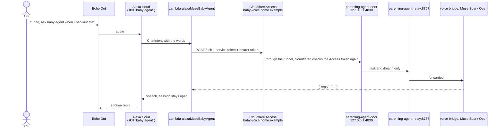

# How "baby agent" reaches the family agent

- No model call in the Lambda. Muse Spark Open answers inside the agent.
- 8 s: the Lambda waits 6 s. If the agent is slower it says a holding line and keeps the Alexa request id. "Again" or
  "de nuevo" asks the bridge for the same id, which returns the first answer and never runs the question twice.
- Role: the Lambda names nobody (env `PA_PERSON` empty). The bridge's skill role is `echo_log` (parenting-agent PR #183):
  questions are read only, as a guest's. A write ("le di 90 ml de mamadera", "cambié un pañal sucio", "se durmió", "se
  despertó", "perdón, eran 100") comes back as one question, "¿Anoto 90 ml de mamadera a las 7:50? Decí sí", with a
  confirm id kept in the session as `pending_write`. Only the next "sí"/"yes" (or AMAZON.YesIntent) sends
  `{"confirm": id}` and the bridge writes it, tagged `echo` in Baby Buddy. "No" sends `{"cancel": id}`, anything else is
  a new utterance. The Lambda sends the request locale as `lang`.
- Interaction model: `ask smapi set-interaction-model -s <skill id> -g development -l es-US --interaction-model
  file:skill-package/interactionModels/custom/es.json` (and en-US), with AMAZON.YesIntent and AMAZON.NoIntent.
- Deploy: `cd lambda && zip function.zip lambda_function.py && aws lambda update-function-code --function-name alexaMuseBabyAgent --zip-file fileb://function.zip --region us-east-1`.
- Tests: `cd lambda && python3 -m unittest test_lambda_function`.

| Piece | Id |
|---|---|
| Skill | `amzn1.ask.skill.00000000-0000-0000-0000-000000000000`, development stage, never submitted |
| Lambda | `alexaMuseBabyAgent`, us-east-1, role `alexaMuseBabyLambdaRole`, invoke locked to the skill id |
| Access app | `baby-voice-origin` (`00000000`) |
| Service token | `alexa-muse-baby-lambda` |
| Agent side | parenting-agent PR #178, issue #177 |
