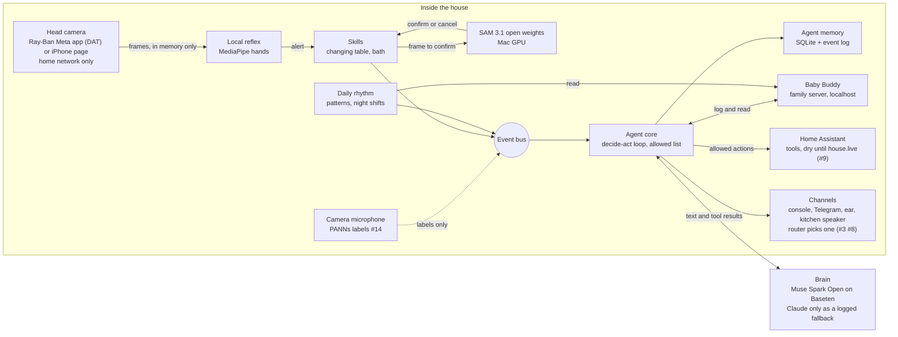

# Architecture

One persistent agent. Every part publishes to and listens on one event bus. Parts marked *planned* are not built yet.

## Parts

| Part | Code | What it does |
|---|---|---|
| Event bus | `parenting_agent/bus.py` | Every event goes through it and to `data/events.jsonl` |
| Agent core | `parenting_agent/agent/` | Decide-act loop, tools with an allowed list, swappable brain, plug-ins |
| Agent memory | `parenting_agent/agent/memory.py` | Conversation and facts in `data/memory.sqlite` |
| Baby Buddy | `docs/deploy-babybuddy.md` | The baby's log on the family server, only on localhost there |
| Brain | `parenting_agent/agent/brain.py` | Muse Spark Open on Baseten through the OpenAI-compatible provider, Claude as a logged fallback when a Muse call errors, or the fake rule-based brain for tests |
| Changing-table skill | `parenting_agent/changing_table.py`, `reflex.py`, `alarm.py`, `skill.py` | Arms, holds notifications, chimes then says "hand", logs the change |
| Camera skills from config | `parenting_agent/camera_skill.py`, `skills/bath.json` | A skill file with an agent block becomes tools, arm and finish phrases, reminders and prompt facts. The bath is the first, see `docs/bath.md` |
| SAM 3.1 confirm | `parenting_agent/sam3_local.py`, `sam3_worker.py` | Confirms or cancels the hand alarm, locally, see `docs/sam3-local.md` |
| Lift check | `parenting_agent/lift.py` | While the reflex reads on, measures how far each hand rose toward the head camera. A lifted hand counts as off and SAM 3.1 cannot cancel it. On the changing table it measures inside SAM 3.1 hand masks, in the bath it needs both hands. Blind set (Oct 29): 22 of 32 hovers, never said hand on 16 touches, 2 touches chimed, the 8 one-hand bath hovers missed by design. Earlier, smaller blind render: 15 of 16 hovers with 2 false alarms on 16 touches. See `results/hover/blind/README.md` |
| Dog near the baby | `parenting_agent/dog_watch.py` | Camera motion sensors or a 30 s snapshot, then SAM 3.1 finds the dog and the baby and measures the gap. Telegram alert, Echo announce in dry run, rate limited, never on a dog alone, see `results/dog-near-baby/README.md` |
| Car seat coach | `parenting_agent/carseat/`, `sam3_prompts_worker.py`, `skills/car-seat.json` | Seat belt install coached by voice, SAM 3.1 checks the belt path, level line and handle, hand checks asked and logged, see `docs/car-seat-coach.md` |
| Head camera | `parenting_agent/sources.py`, `phone.html` | iPhone page streaming frames to the Mac over Tailscale |
| Ray-Ban Meta glasses | `apps/glasses`, `parenting_agent/glasses.py` | iPhone app on Meta's Wearables Device Access Toolkit: glasses camera sampled to 10 fps and sent to the Mac on the home network with a pairing token, the agent's replies and "hand" spoken back. Simulator with DAT's mock glasses so far, see `results/glasses/README.md` |
| Daily rhythm | `parenting_agent/rhythm/` | Next feed, unusual days, night summary, night shifts |
| Channels | `parenting_agent/channels/` | Messaging adapter interface, Telegram long polling with a family allowlist, router for ear, speaker, Telegram or partner |
| House | `parenting_agent/house.py`, `house_tools.py` | Home Assistant tools behind the policy: alone, only with a yes, never. Dry except the actions in `house.live_actions` (`house_live.py`: the night feed's study light and nap mode's vacuum pause and dock, live since Oct 30), every call logged as a `house_call`, `house_dry` or `house_live` event |
| Always on | `deploy/`, `parenting_agent/agent/heartbeat.py` | The agent in a walled-off container on the Vostro, see `docs/deploy-agent.md` |
| House sounds | `parenting_agent/hearing.py`, `house_sounds.py`, `cry_reason.py`, `white_noise.py` | Cry, doorbell and dog as events, a likely reason for a cry from the log, simulated white noise, see `docs/house-sounds.md` |
| House plan | `parenting_agent/house_plan.py`, `meals.py` | Vacuum around naps, room cleans, the daily run, the shopping list, fast dinners after a bad night (Cookidoo read only through home-agents), dinner timing, white noise on the rhythm, see `docs/house-plan.md` |
| Day engine | `parenting_agent/day_engine.py`, `house_jobs.py`, `day_sim.py` | Nap mode for the whole house, the door, floor clean before tummy time (ask first), morning brief, supplies, parents' meals after a hard night, all through one dry-run writer, see `results/house-jobs/README.md` and `results/house-day/README.md` |
| House brain | `parenting_agent/house_brain.py` | Muse Spark Open plans the house: at bedtime, at each wake-up, after a night feed and before each predicted nap, and at once on something unusual (a long sleep, a parent asking to sleep, a dog, a visitor). It answers in a strict JSON schema that names routines and times, never devices. Plain code checks each item against the clock and the safety gate and arms the day engine and the night feed with it. A slow, failed or invalid answer leaves the fixed rules running and is logged. Tonight's plan on Telegram, a morning explanation on Telegram and the Echo (dry). See `results/muse-house/README.md` |
| Night feed | `parenting_agent/night_feed.py`, `virtual_devices.py` | The 3 AM feed: a guess from the log rhythm only pre-warms the bottle warmer plug, silently (virtual, dry). Only a real awake signal (a night cry, a parent saying he is up, a "he's up" event, a wake-up or feed in the log) turns the study light dim and warm, lowers the white noise and pushes the parent on duty. A per-night cap on warmer minutes across all switch-ons. Wound down when the feed is logged by voice. See `results/night-feed/README.md` |
| Laundry | `parenting_agent/laundry.py` | The washer cycle from a power plug (virtual, dry), "move it to the dryer", a daily reminder when no baby load ran, clean bodysuits counted from the log. See `results/laundry/README.md` |
| Echo and Assist voice | `parenting_agent/voice_bridge.py`, `deploy/home-assistant/` | Talk to the agent through the kitchen Echo (core Alexa Devices voice event) or Home Assistant Assist (custom sentences, intent_script, rest_command), on a token-protected private endpoint. See `docs/echo-and-assist.md` |
| Sitter handover | `parenting_agent/sitter.py` | Handover brief from the log, parent approves first, time-boxed guest role, summary after, see `docs/sitter-handover.md` |
| Families | `parenting_agent/families/` | Invited parents on a second Telegram bot, one SQLite log per family, a separate walled-off service, see `docs/families.md` |
| Before he arrives | `parenting_agent/prep/` | Prep lists (nursery from the home twin, hospital bag, car seat, white noise machine), appointments, the countdown and one morning nudge to Gonza. Logistics only. Every turn and prep change logged with the person, see `docs/before-he-arrives.md` |
| Tesla | `parenting_agent/tesla/` | A simulated Model 3 with the `tesla_fleet` entity ids today, the real car through Home Assistant from Nov 5. Cabin ready, car naps, the Child Left Alone Detection check, every command after the parent's yes. See `docs/tesla.md` |
| Simulated week | `simweek/` | A realistic tagged week in Baby Buddy for tests and demos |

## Data flows

| Flow | From | To | Leaves the house? |
|---|---|---|---|
| Camera frames | Head camera (iPhone page) | Reflex and SAM 3.1 on the Mac | No. Over the home Wi-Fi or Tailscale to the Mac (end to end encrypted, a Tailscale relay would see only encrypted packets), in memory only, never saved |
| Confirm or cancel | SAM 3.1 | Skill, then bus | No |
| Baby log entries | Agent core | Baby Buddy on the family server | No |
| Rhythm reads | Baby Buddy | Daily rhythm | No |
| Conversation and tool results | Agent core | Brain | **Yes.** Baseten for Muse Spark Open, Anthropic only for a fallback call. With Telegram, voice notes, the car from Nov 5 and the two opt-in Muse senses below, the only flows that leave. Each call logs its model and host as a `brain_call` event, each fallback a `brain_fallback` event |
| House actions | Agent core | Home Assistant on the family server | No. Dry except the study light and the vacuum pause and dock, live since Oct 30 |
| House sound labels | Camera microphone | Bus | No. Audio stays in memory, never saved |
| Car seat second opinion (opt-in, `car_seat.muse`) | Head camera, one zoomed still per camera step | Muse Spark Open on Baseten | **Yes**, as part of the brain call. Only that still, made in memory, never saved. Each call is a `carseat_muse` event with its host |
| Cry reason guess (opt-in, `house_sounds.muse_audio`, off by default) | The first 5 s of a cry PANNs detected | Muse Spark Open on Baseten | **Yes**, as part of the brain call, only after a synthetic canary clip passes. The clip is dropped after the one call. Each call is a `cry_sound_guess` event. No other room audio is ever sent |
| A parent's voice note (voice is on by default in the family agent and the families bot) | Telegram, sent by the parent | Muse Spark Open on Baseten, the ear (`parenting_agent/voice/ear.py`) | **Yes**, the audio of that one note, to be written down. Converted to WAV by the voice service in the house, held in memory, sent once to inference.baseten.co, never saved. Baseten's docs say it does not store inputs or outputs by default (https://docs.baseten.co/observability/security). Muse hears speech, not other sounds (`results/audio-truth/README.md`). Nothing is kept but the words heard. The spoken reply is made in the house (MMS-TTS), see `docs/voice.md` |
| Car readings and commands | Agent core | Simulated car today, Home Assistant `tesla_fleet` from Nov 5 | From Nov 5, yes: Home Assistant polls and commands the car through Tesla's Fleet API. Only the public key file is public |
| A parent talking to the Echo (when Gonza turns it on, `docs/echo-and-assist.md`) | The kitchen Echo, then Home Assistant, then the voice bridge | The agent, then the Echo | **Yes**, to Amazon: Alexa hears the words in Amazon's cloud as every Alexa command does, and the agent's answer goes to Amazon to be said on the Echo, like the announcements. Assist with a local speech engine stays in the house |
| Messages to parents | Agent core, router | Ear, kitchen speaker, Telegram | Telegram messages go through Telegram's servers. The ear and the speaker stay in the house |

## Rules the code keeps

- Anything not on the allowed list waits for a parent's yes.
- Built to refuse medical advice and diagnosis. Red flags get: call 911 now. The agent never calls anyone itself. A rule gate (`parenting_agent/agent/rules.py`) refuses health questions and answers red flags with emergency services without a brain call. What the word lists miss rests on the brain's prompt.
- Baby log entries are never timed in the future.
- A camera skill never says or implies the baby can be left alone, and never offers to watch the baby in the parent's place. Checked when the skill loads.
