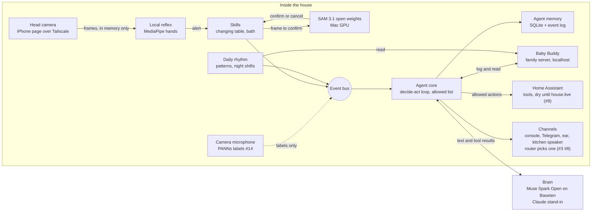

# Architecture

One persistent agent. Every part publishes to and listens on one event bus. Parts marked *planned* are not built yet.

## Parts

| Part | Code | What it does |
|---|---|---|
| Event bus | `parenting_agent/bus.py` | Every event goes through it and to `data/events.jsonl` |
| Agent core | `parenting_agent/agent/` | Decide-act loop, tools with an allowed list, swappable brain, plug-ins |
| Agent memory | `parenting_agent/agent/memory.py` | Conversation and facts in `data/memory.sqlite` |
| Baby Buddy | `docs/deploy-babybuddy.md` | The baby's log on the family server, only on localhost there |
| Brain | `parenting_agent/agent/brain.py` | Fake, Claude stand-in, or any OpenAI-compatible endpoint (Muse Spark Open on Baseten) |
| Changing-table skill | `parenting_agent/changing_table.py`, `reflex.py`, `alarm.py`, `skill.py` | Arms, holds notifications, chimes then says "hand", logs the change |
| Camera skills from config | `parenting_agent/camera_skill.py`, `skills/bath.json` | A skill file with an agent block becomes tools, arm and finish phrases, reminders and prompt facts. The bath is the first, see `docs/bath.md` |
| SAM 3.1 confirm | `parenting_agent/sam3_local.py`, `sam3_worker.py` | Confirms or cancels the hand alarm, locally. Touch versus a 2 to 5 cm hover is not solved yet, see `results/hover/README.md` and `docs/sam3-local.md` |
| Car seat coach | `parenting_agent/carseat/`, `sam3_prompts_worker.py`, `skills/car-seat.json` | Seat belt install coached by voice, SAM 3.1 checks the belt path, level line and handle, hand checks asked and logged, see `docs/car-seat-coach.md` |
| Head camera | `parenting_agent/sources.py`, `phone.html` | iPhone page streaming frames to the Mac over Tailscale |
| Daily rhythm | `parenting_agent/rhythm/` | Next feed, unusual days, night summary, night shifts |
| Channels | `parenting_agent/channels/` | Messaging adapter interface, Telegram long polling with a family allowlist, router for ear, speaker, Telegram or partner |
| House | `parenting_agent/house.py`, `house_tools.py` | Home Assistant tools behind the policy: alone, only with a yes, never. Dry until `house.live` is true, every call logged as a `house_call` event |
| Always on | `deploy/`, `parenting_agent/agent/heartbeat.py` | The agent in a walled-off container on the Vostro, see `docs/deploy-agent.md` |
| House sounds | `parenting_agent/hearing.py`, `house_sounds.py`, `cry_reason.py`, `white_noise.py` | Cry, doorbell and dog as events, a likely reason for a cry from the log, simulated white noise, see `docs/house-sounds.md` |
| House plan | `parenting_agent/house_plan.py`, `meals.py` | Vacuum around naps, room cleans, the daily run, the shopping list, fast dinners after a bad night (Cookidoo read only through home-agents), dinner timing, white noise on the rhythm, see `docs/house-plan.md` |
| Sitter handover | `parenting_agent/sitter.py` | Handover brief from the log, parent approves first, time-boxed guest role, summary after, see `docs/sitter-handover.md` |
| Families | `parenting_agent/families/` | Invited parents on a second Telegram bot, one SQLite log per family, a separate walled-off service, see `docs/families.md` |
| Before he arrives | `parenting_agent/prep/` | Prep lists (nursery from the home twin, hospital bag, car seat, white noise machine), appointments, the countdown and one morning nudge to Gonza. Logistics only. Every turn and prep change logged with the person, see `docs/before-he-arrives.md` |
| Tesla | `parenting_agent/tesla/` | A simulated Model 3 with the `tesla_fleet` entity ids today, the real car through Home Assistant from Nov 5. Cabin ready, car naps, the Child Left Alone Detection check, every command after the parent's yes. See `docs/tesla.md` |
| Simulated week | `simweek/` | A realistic tagged week in Baby Buddy for tests and demos |

## Data flows

| Flow | From | To | Leaves the house? |
|---|---|---|---|
| Camera frames | Head camera | Reflex and SAM 3.1 on the Mac | No. In memory only, never saved |
| Confirm or cancel | SAM 3.1 | Skill, then bus | No |
| Baby log entries | Agent core | Baby Buddy on the family server | No |
| Rhythm reads | Baby Buddy | Daily rhythm | No |
| Conversation and tool results | Agent core | Brain | **Yes, the only flow that does.** Baseten for Muse Spark Open, Anthropic for the stand-in. Each call logs its host as a `brain_call` event |
| House actions | Agent core | Home Assistant on the family server | No. Dry until `house.live` is true |
| House sound labels | Camera microphone | Bus | No. Audio stays in memory, never saved |
| Car readings and commands | Agent core | Simulated car today, Home Assistant `tesla_fleet` from Nov 5 | From Nov 5, yes: Home Assistant polls and commands the car through Tesla's Fleet API. Only the public key file is public |
| Messages to parents | Agent core, router | Ear, kitchen speaker, Telegram | Telegram messages go through Telegram's servers. The ear and the speaker stay in the house |

## Rules the code keeps

- Anything not on the allowed list waits for a parent's yes.
- No medical advice and no diagnosis in anything the agent says.
- Baby log entries are never timed in the future.
- A camera skill never says or implies the baby can be left alone, and never offers to watch the baby in the parent's place. Checked when the skill loads.
