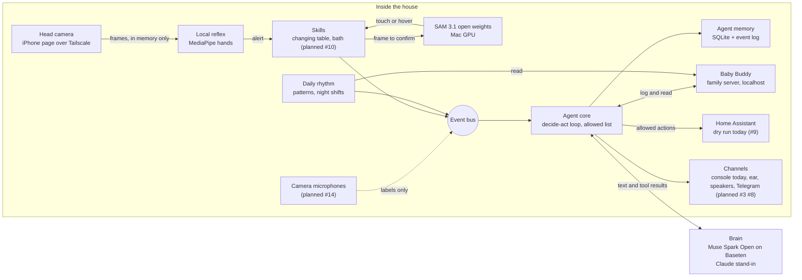

# Architecture

One persistent agent. Every part publishes to and listens on one event bus. Parts marked *planned* are not built yet.

## Parts

| Part | Code | What it does |
|---|---|---|
| Event bus | `parenting_agent/bus.py` | Every event goes through it and to `data/events.jsonl` |
| Agent core | `parenting_agent/agent/` | Decide-act loop, tools with an allowed list, swappable brain, plug-ins |
| Agent memory | `parenting_agent/agent/memory.py` | Conversation and facts in `data/memory.sqlite` |
| Baby Buddy | `docs/deploy-babybuddy.md` | The baby's log on the family server, only on localhost there |
| Brain | `parenting_agent/agent/brain.py` | Fake, Claude stand-in, or any OpenAI-compatible endpoint (Muse Spark Open on Baseten) |
| Changing-table skill | `parenting_agent/changing_table.py`, `reflex.py`, `alarm.py`, `skill.py` | Arms, holds notifications, chimes then says "hand", logs the change |
| SAM 3.1 confirm | `parenting_agent/sam3_local.py`, `sam3_worker.py` | Touch versus hover, locally, see `docs/sam3-local.md` |
| Head camera | `parenting_agent/sources.py`, `phone.html` | iPhone page streaming frames to the Mac over Tailscale |
| Daily rhythm | `parenting_agent/rhythm/` | Next feed, unusual days, night summary, night shifts |
| House | `parenting_agent/house.py` | Home Assistant actions behind the allowed list, dry run today |
| Always on | `deploy/`, `parenting_agent/agent/heartbeat.py` | The agent in a walled-off container on the Vostro, see `docs/deploy-agent.md` |
| Simulated week | `simweek/` | A realistic tagged week in Baby Buddy for tests and demos |

## Data flows

| Flow | From | To | Leaves the house? |
|---|---|---|---|
| Camera frames | Head camera | Reflex and SAM 3.1 on the Mac | No. In memory only, never saved |
| Touch or hover result | SAM 3.1 | Skill, then bus | No |
| Baby log entries | Agent core | Baby Buddy on the family server | No |
| Rhythm reads | Baby Buddy | Daily rhythm | No |
| Conversation and tool results | Agent core | Brain | **Yes, the only flow that does.** Baseten for Muse Spark Open, Anthropic for the stand-in. Each call logs its host as a `brain_call` event |
| House actions | Agent core | Home Assistant on the family server | No. Dry run today |
| House sound labels (planned) | Camera microphones | Bus | No. Audio never saved |
| Messages to parents (planned) | Agent core | Ear, speakers, Telegram | Telegram messages go through Telegram's servers when that channel ships |

## Rules the code keeps

- Anything not on the allowed list waits for a parent's yes.
- No medical advice and no diagnosis in anything the agent says.
- Baby log entries are never timed in the future.
