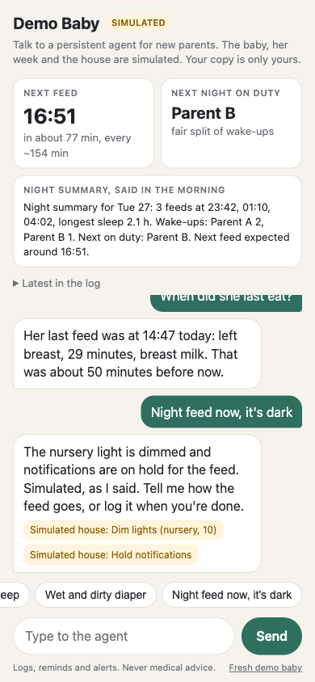

# Public demo app

A phone-first web chat where a visitor talks to the real agent core about Theo, a simulated baby boy a few weeks old, the same baby as the story. Nothing on the page is a real child. Built during the Meta hackathon. Live at https://baby.bygmv.com since Oct 28 2026.



## What a visitor can do

- Ask about the baby's day: "when did he last eat?", "how much did he drink today?". Answers come from the log through the same `baby_summary` and `read_baby_log` tools the family agent uses.
- Ask "why is he crying?" (a chip). The answer is the likely reason from the log (hungry, tired, a diaper, or no clear reason), the same path as the families bot, with no brain call, and always says it is a guess, never a diagnosis. A red flag ("crying and not breathing") still gets the emergency line, and crying with a health question gets the refusal.
- Add entries by text: "bottle 120 ml", "wet and dirty diaper", "he just fell asleep". Only what the visitor said is kept: "bottle 120 ml just now" has no milk type, no start and no length, at the time of the message. Fix or remove them: "that was 90 ml, fix it", "delete the last one". A value no real entry can have, like 9000 ml, a feed longer than 120 min, a sleep longer than 14 hours or a time in the future, is asked about and never logged.
- See what the agent says first: the next feed, the night summary and who is next on duty, computed by the daily rhythm engine from the visitor's own log. During the night (22:00 to 06:00) the summary is the night in progress ("Tonight so far, since Wed 28 22:00"), in the day it is the night that just ended with both dates. Ask "who is up next tonight?" and the agent answers from the `night_rota` tool, which reads the same wake-ups as the panel, so the two always agree.
- Prep mode, the "Before he arrives" tab: the before-he-arrives tools (docs/before-he-arrives.md) on simulated lists, with a due date 47 days from today so the countdown and the list dates always look current. "Show the hospital bag list", "what is next before he arrives?", "where should the crib go?", "we packed the chargers". A message about the hospital bag, the nursery, the crib, the car seat or the due date goes to prep mode from either tab. Real names in the lists read Parent A and Parent B, house device ids are removed, an appointment with an address is not kept, and copying a list to Home Assistant is not in the demo at all.
- Spanish: with a Spanish browser the page is `es-UY` with voseo chips ("Mamadera 120 ml", "¿Por qué llora?"). Every message is answered in its own language: the refusal, the emergency line, the edit reply ("nono eran 70" gets "Corregí la mamadera de las 01:07: 90 ml → 70 ml."), the cry reason and the night summary. The prep list items stay in English, the agent answers about them in Spanish.
- A link to the page shows a preview card: Open Graph and Twitter tags with the title "Theo's agent, a simulated baby" and a 1200 x 630 card rendered from `parenting_agent/demo/og.svg` (`rsvg-convert -w 1200 -h 630 og.svg -o og.png`), served at `/og.png`.
- See what the agent would do in the house. House tools are simulated and every action is labelled "Simulated house" in the chat. The speakers say only fixed sentences ("Could someone bring a clean diaper and wipes, please?"), never free text, so a code typed in a message is never read aloud. Calling the partner shows "Waits for your yes" and the reply names exactly what waits. A yes runs it, simulated, only when it answers that question within 3 minutes. Any other message cancels it, so a stale "ok" runs nothing.
- Health questions get the kind refusal without a brain call. A health message that reports something to keep, a dose already given or a milestone, is logged as a note in the visitor's words, and only the advice part is refused. The reply is built from the log, never from the brain's words.
- The demo keeps no facts about a visitor. There is no remember tool, so a real name is never saved as the baby's name.

## How it is built

| Part | Code |
|---|---|
| Settings, the environment scrub, reading only the brain key | `parenting_agent/demo/settings.py` |
| Theo's log, the simulated week moved to today, in memory | `parenting_agent/demo/babylog.py` |
| One agent per visitor, spend cap, caps, simulated house tools, the cry reason, the night rota, prep mode, Spanish | `parenting_agent/demo/app.py` |
| Web server and page, standard library only | `parenting_agent/demo/server.py`, `page.html` |
| Session records and the export | `parenting_agent/demo/records.py`, `export_sessions.py` |
| Docker files and the wall check | `deploy/demo/` |
| Deploy, check, rollback, backups | `deploy/public.sh`, `deploy/backup.sh` |

Each visitor gets their own agent with its own bus, an in-memory memory file and a fresh copy of the simulated week (`simweek.generate`, seed 7), with the last day placed on today and nothing in the future. Visitors never share state. "Fresh demo baby" gives the visitor a new copy. Idle visitors are dropped from memory after 6 hours.

## Walled off

- The demo never loads the family env file. `--brain-env FILE` reads only `ANTHROPIC_API_KEY` or `BASETEN_API_KEY` from it and ignores every other line.
- At start, every variable that could reach the house or holds a secret is removed from the process environment: Home Assistant, Baby Buddy, Telegram, tunnels, tokens and other keys. Only their names are printed.
- The demo has no Baby Buddy client, no Home Assistant client and no channel plug-in. A test checks the demo code imports none of them and that a conversation with the fake brain opens no network connection.
- In Docker (`deploy/demo/compose.yml`) the container sits on an internal network with no gateway and no host address. Its only way out is a proxy that allows HTTPS to `api.anthropic.com` and `inference.baseten.co`. A small relay publishes the port on 127.0.0.1 only. No host networking. `deploy/demo/check-wall.sh` probes Home Assistant and Baby Buddy from inside the container after a deploy.

## Caps

| Cap | Default | Setting |
|---|---|---|
| Messages per visitor | 25 (internal visitors are not capped) | `PA_DEMO_MAX_MESSAGES` |
| Messages per connection per day, whatever the cookie | 100 | `PA_DEMO_MAX_CLIENT_MESSAGES` |
| New demo babies per connection per hour (first message or reset) | 10 | `PA_DEMO_MAX_CLIENT_VISITORS` |
| Visitors in memory, then "the demo is full" | 1000 | `PA_DEMO_MAX_VISITORS` |
| A visitor quiet for less than this is never evicted to make room | 10 min | `PA_DEMO_PROTECT_S` |
| Brain spend per UTC day, then "the demo is resting" | $2.00 | `PA_DEMO_DAILY_USD` |
| Messages per day from strangers, a second guard | 1500 | `PA_DEMO_MAX_DAILY_MESSAGES` |
| Message length | 300 characters | `PA_DEMO_MAX_INPUT` |
| Request body | 4 KB of JSON, no uploads, multipart refused | fixed |
| Brain calls at once | 4 | `PA_DEMO_PARALLEL` |

A connection is the address in `CF-Connecting-IP`, which Cloudflare sets on every request through the tunnel and a visitor cannot change (`PA_DEMO_CLIENT_HEADER`, the socket address when unset). An IPv6 address counts by its /64. It is held only as an HMAC under a key made at start, in memory, never stored or logged, and a restart forgets it. Page loads (`GET /api/state`) never create a visitor: a browser with no demo yet sees a fresh copy built once a minute, so cookie-less requests cannot fill the demo or push anyone out (issue #60).

The brain is Muse Spark Open on Baseten, with Claude Haiku 5.5 only when a Muse call errors (a `brain_fallback` event). Spend is computed from the tokens each call reports, at the price of the brain that answered: Muse Spark Open $1.25 input and $4.25 output per million tokens (Baseten library page, read Oct 28 2026), Claude Haiku 5.5 $0.10 and $0.50 (Anthropic pricing page, read Oct 28 2026). A call that reports no usage is charged a fallback of 4000 input and 400 output tokens. A local run of 22 brain calls cost $0.006.

## Session records for the real-user scorer

SQLite at `data/demo_sessions.sqlite`, table `sessions(ts TEXT ISO8601 UTC, visitor_id TEXT, channel TEXT, kind TEXT, internal INTEGER)`.

- One row per visitor message the demo takes in: answered, refused, resting or busy. Empty, too long and over-the-limit messages write no row.
- `ts` is UTC like `2026-10-28T18:34:17+00:00`. `channel` is `web`. `kind` is `demo`.
- `visitor_id` is the sha256 of a random first-party cookie `pa_vid`. Never an IP, and no IP is logged anywhere.
- `internal` is 1 when the browser has the internal cookie (visit `/internal/<secret>` once) or the request comes from localhost with no proxy headers. The secret is `PA_DEMO_INTERNAL_SECRET`, and the cookie holds a signature of it, never the secret, so a cookie made by hand does not count and a new secret unmarks every browser. Plain `/internal`, a wrong secret and any other `/internal/...` address answer a 404. With the secret unset or shorter than 32 characters, every `/internal` address is a 404. A request that came through a proxy (`X-Forwarded-For`, `CF-Connecting-IP`, `Forwarded`, `X-Real-IP`) is not treated as localhost.
- No message text is stored. The same file also holds a `spend` table that the scorer ignores.

```bash
python -m parenting_agent.demo.export_sessions          # JSON lines, oldest first
python -m parenting_agent.demo.export_sessions --db other/demo_sessions.sqlite
```

## Run it locally

```bash
python -m parenting_agent.demo --brain-env ~/.parenting-agent.env   # Muse Spark Open, Claude fallback
PA_DEMO_BRAIN=fake python -m parenting_agent.demo                                                  # offline rules
PA_DEMO_BRAIN=claude python -m parenting_agent.demo --brain-env ...                                # Claude Haiku alone, for comparison
```

Then open http://127.0.0.1:8765 on a phone-sized window. Local visits count as internal.

## On the Vostro

Deployed on Oct 28 2026. Three containers in the compose project `pa-demo`: `pa-demo` (only on the internal network `pa-demo-internal`, isolated gateway, no host address), `pa-demo-egress` (tinyproxy, HTTPS to the brain hosts only) and `pa-demo-edge` (socat, published on 127.0.0.1:4820 only). The Cloudflare tunnel sends `baby.bygmv.com` to that port. Base images are pinned by digest and the images are tagged with the git commit.

- Env file `~/apps/pa-demo.env`, mode 600, three names: `BASETEN_API_KEY`, `ANTHROPIC_API_KEY` (the fallback) and `PA_DEMO_INTERNAL_SECRET`. `push-env` makes the secret on the Vostro the first time (32 random bytes, hex) and keeps it on later pushes.
- Data `~/apps/pa-demo-data`, owned by the container user (uid 10001), mode 700.
- Backups: `pa-backup.timer` (systemd user unit) copies every SQLite file of the demo and the families service daily at about 04:40 into `~/backups/parenting-agent-public`, keeps 7 days.
- Mark your own browser as internal before testing: open the address in `~/Engineering/gonza/meta-hackathon-2026/internal-url.txt` once. `sh deploy/public.sh demo internal-url FILE` writes it there (mode 600) without printing it. That file is excluded from git like `invites.txt`. Browsers marked with the old `/internal` address before Oct 28 evening are no longer internal.

```bash
sh deploy/public.sh demo push-env     # BASETEN_API_KEY and ANTHROPIC_API_KEY from the meta-hackathon-2026 .env, the internal secret kept or made
sh deploy/public.sh demo internal-url ~/Engineering/gonza/meta-hackathon-2026/internal-url.txt
WALL_EXTRA_TARGETS="192.0.2.10:80 192.0.2.10:22" sh deploy/public.sh demo deploy
sh deploy/public.sh demo check | status | logs 200 | stop | start
sh deploy/public.sh backup install | run
```

A deploy fails, stops the demo and starts the previous commit again when the health check or the wall check fails. The wall check probes every address of the Vostro on ports 22, 80, 8123 and 8790, the family agent's relay, the router, the Mac and the internet, directly and through the proxy, and checks the env holds no secret but the brain key and the internal secret. On Oct 28 all 103 probes were blocked or refused.

## Red team, round 1 (issue #60)

The agentic red-teamer judge landed 8 attacks on Oct 28. Each is now a test in `tests/test_redteam_r1.py` that replays it, failed on main before the fix and passes after. See `results/redteam/README.md`.
