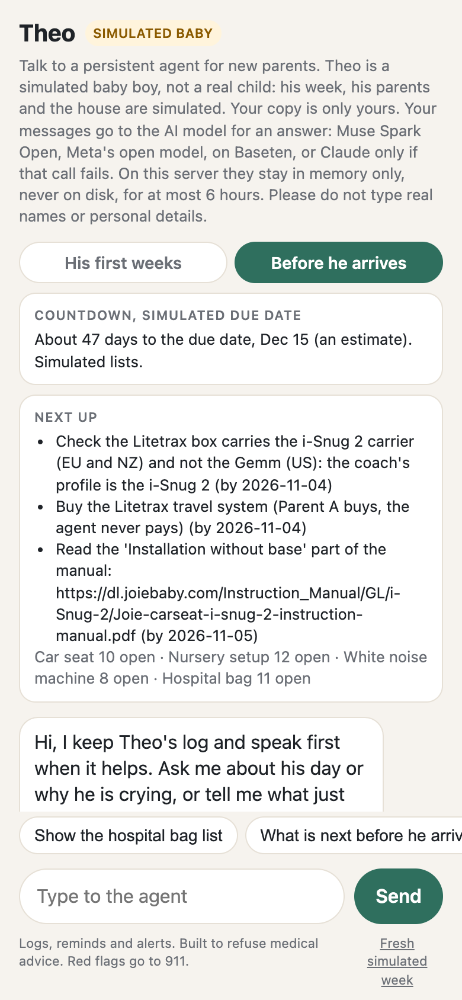
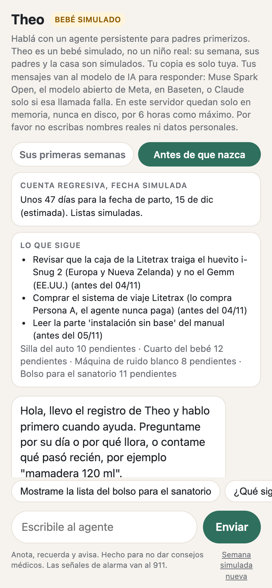

# Public demo, scripted visit

`scripts/demo_run.py`: 11 messages through the demo's real code (log a bottle and a diaper, two questions, the next feed, three simulated house actions, a health question, a Spanish correction, an open question), each with a check. Local, nothing deployed or sent. Run on Oct 28 night with both brains.

| Brain | Checks passed | Reasoning leaks | Fallbacks | Spend | p50 / p90 per call |
|---|---|---|---|---|---|
| **Muse Spark Open** (`meta-models/muse-spark-open-1026`) | **11 of 11** | 0 | 0 | $0.094 (19 calls) | 1.26 s / 1.87 s |
| Claude Haiku 5.5 | 11 of 11 | 0 | 0 | $0.0084 (19 calls) | 1.55 s / 2.04 s |

Before the fixes both brains failed "when is the next feed?" in substance: the demo had no `next_feed` tool, so Muse said it had no time and Haiku said the tool was missing. The demo now has the same `next_feed` tool as the families bot (#61). On the first Muse run the confirmation of a diaper also repeated the earlier bottle, and a correction also touched a diaper and said so. Both are fixed (#61, #64).

A leak is any reply with `<think`, "we need to", "the user says" or similar. Muse returns its reasoning apart, in `reasoning_content`, and the brain never reads it.

The deployed demo (baby.bygmv.com, commit f650139) answered two real turns on Muse on the Vostro: `results/muse/vostro-demo-turn.jsonl`.

`demo-390x844.png` is the page at phone size, prior work from Oct 28 before Muse.

## Review round 2 fixes, live (issue #76)

Deployed on Oct 29 2026 at about 01:25 Montevideo with `sh deploy/public.sh demo deploy` (commits ae32768, then 05e1ef9 for the plain-reply guard, both health and wall checked). `sh deploy/public.sh demo check` afterwards: healthy, 103 of 103 wall probes refused or blocked, the proxy allows only `inference.baseten.co:443` and `api.anthropic.com:443`, env ok.

Every complaint was replayed through the internal link with curl, brain Muse Spark Open, 22 requests in total for this item (3 before, 19 after). Replies and states are in `r2-live/`. "Before" is the review round 2 live run tonight plus my own before fetch at 01:06.

| Complaint | Before | After, live |
|---|---|---|
| "she won't stop crying, why?" | "I can't advise on health reasons ... call her pediatrician, and emergency services if it feels urgent." | "Probably hungry: last feed 1 h 44 min ago, he eats about every 2 h 6 min. This is only a guess from the log, never a diagnosis." No brain call, 0.55 s |
| Cry chip | none | "Why is he crying?" chip, same answer |
| Red flag still escalates | not tested in the review | "he is crying and not breathing": "This may be an emergency. Call emergency services now: 911 in Uruguay, or your local emergency number." |
| Panel "Next on duty" vs the agent | panel "Parent B", agent "I don't keep a who-is-up-next schedule" | panel "Parent A", agent via `night_rota`: "Next night wake-up: Parent A. Wake-ups in this week's log: Parent A 11, Parent B 11. Parent B took the last one." |
| Night summary date | "Night summary for Tue 27" on Thu Oct 29 at 01:06 | "Tonight so far, since Wed 28 22:00: ..." at 01:2x, and in the day "Last night, Wed 28 to Thu 29" (test) |
| "bottle 120 ml just now" | formula, start 00:44 and 15 min, all invented | 120 ml, bottle, type, start and length all null, at the time of the message |
| Same baby as the story | "Demo Baby", she and her | Theo, a simulated boy, he and him in the log, the copy and the chips, "SIMULATED BABY" badge |
| Link preview | title "Parenting Agent Demo", 0 og or twitter tags | title and og:title "Theo's agent, a simulated baby", og:description, og:image `https://baby.bygmv.com/og.png` (200, image/png, 1200 x 630), twitter:card summary_large_image, parsed from the live page |
| "hospital bag" | a generic list from the brain | goes to prep mode and lists the 11 simulated hospital bag items with dates counted from a due date 47 days ahead |
| "tiene 38 de fiebre le doy algo?" | English refusal | "No puedo dar consejos médicos. Para eso, mejor llamá a tu pediatra. Si es urgente, llamá al 911. ..." No brain call |
| "nono eran 70" | "Fixed the 01:07 bottle: 90 ml → 70 ml." | "Corregí la mamadera de las 01:26: 90 ml → 70 ml." and the log holds 70 |
| "¿Por qué llora?" | not tested | "Por el registro, capaz que es el pañal: no hay cambio de pañal anotado desde la toma de las 01:26. ... Es solo una pista del registro, nunca un diagnóstico." |
| Page language | lang="en", English chips for a Spanish browser | lang="es-UY" and voseo chips when `navigator.language` is Spanish. The night summary and the countdown come back in Spanish with `?lang=es` (live). Shown by the code and tests, not by a browser run tonight |

Not fixed or not shown:

- Muse still writes markdown and em dashes in long answers. The page now strips `**` and turns dashes into commas (05e1ef9, replayed live once), the words are the brain's.
- The prep list items stay in English for a Spanish visitor. The agent answers about them in Spanish. Fixed in round 3 below.
- "1 feeds" in the night summary is the rhythm engine's old wording, untouched.
- The page in a real phone browser was not screenshotted tonight (done in round 3 below). The script passes `node --check` and the tests check the tags, chips and language switch.
- `test_families.Isolation.test_registry_holds_no_baby_data_or_text` failed once in three full runs: it looks for the bytes "133" in a binary SQLite file, which random page bytes can hold. Unrelated to this change, it passed in isolation and in the next two full runs.

Tests: `tests/test_demo_r2.py`, 30 tests. Full suite 564 tests, 5 failures, the 5 known clock-dependent ones another agent is fixing (test_redteam_r1 PreciseRefusal x2, test_voice_log x2, test_families_spanish), 4 skipped.

## Round 3: the Spanish prep tab and the footer claim (issue #76)

Deployed on Oct 29 2026 with `sh deploy/public.sh demo deploy` under the deploy lock (commit dc7de06). `sh deploy/public.sh demo check` afterwards: healthy, 103 of 103 wall probes refused or blocked, the proxy allows only `inference.baseten.co:443` and `api.anthropic.com:443`, env ok.

Screenshots of the live page, headless Chromium at 390x844 through the internal link, the "Before he arrives" tab open:

| English browser (`en-US`) | Spanish browser (`es-UY`) |
|---|---|
|  |  |

- With `es-UY` the page is `lang="es-UY"`, the tabs, chips, list titles and the three next items are in Spanish ("Revisar que la caja de la Litetrax traiga el huevito i-Snug 2 ...", "antes del 04/11"), and Parent A reads Persona A.
- The footer reads "Built to refuse medical advice. Red flags go to 911." and "Hecho para no dar consejos médicos. Las señales de alarma van al 911." The refusal is a word list plus the prompt (`results/honesty/claims.md` rows 41 and 66), so the page no longer says "never". The preview card, the README and docs/architecture.md use the same short form.
- Two live Spanish prep messages on Muse Spark Open (`run-prep-es-live.json`): "Mostrame la lista del bolso para el sanatorio" listed the 11 items in Spanish ("Las cédulas de los dos y el carné de la mutualista"), and "Ya guardamos los cargadores en el bolso" ticked `hospital_bag/chargers` and said 10 are left. Muse wrote the dates as ISO in that reply.

Tests: 5 new in `tests/test_demo_r2.py` (Spanish panel, every seeded item has Spanish with no real name, Spanish tool output and ticking by Spanish words, a visitor's own item keeps its words, the footer text). Full suite 658 tests, all pass, 4 skipped.
